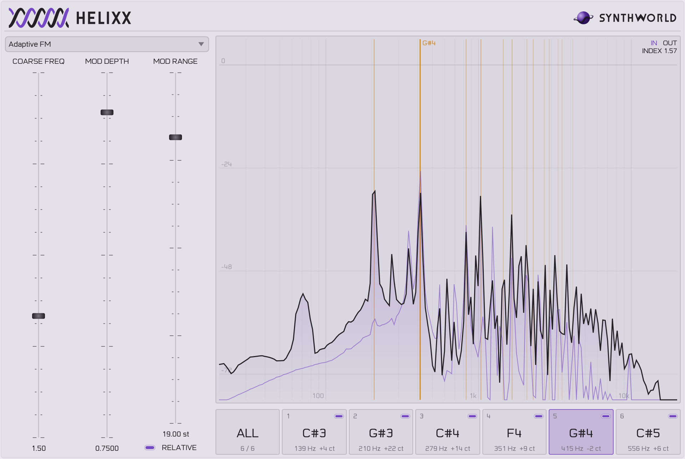

# Helixx

**Adaptive FM for hexaphonic guitars and other multichannel sources.** Helixx is an audio effect that follows the pitch of each channel on its own and frequency-modulates that channel with its own modulator, so a whole chord can go through FM without turning to mud.

More on the [Helixx page](https://synthworldaudio.com/synths/helixx/) at SynthWorld.



<sub>Adaptive FM on a hexaphonic guitar recording. All six strings are tracked, and string 5 is selected in the spectrum: the purple curve is the input, the black one the output, and the orange lines mark the pitch and where its sidebands should land.</sub>

## Why one modulator per channel

Distortion and FM usually fall apart on chords, because every note modulates every other one and the result is a wash of intermodulation. A hexaphonic pickup avoids that by giving each string its own channel, and Helixx treats each of those channels as a separate monophonic voice. Each one gets:

- a **pitch detector** (YIN, 60 Hz to 1.5 kHz)
- a **sine modulator** running at `detected pitch × COARSE FREQ`
- its own **modulated delay line or filter**

Nothing is specific to the guitar or to six channels. Helixx accepts 1 to 32 channels, as long as inputs and outputs match, so it also works on a stem split into mono parts, or on a stereo pair where each side carries one voice. Each channel does need to be monophonic: a chord on a single channel gives the pitch detector nothing clear to follow.

Processing runs at 4× oversampling to keep the sidebands from aliasing.

## Algorithms

All three share the same modulator and differ in what it acts on.

| Algorithm | The modulator drives | Character | Reference |
| --- | --- | --- | --- |
| **Adaptive FM** | The delay time of a fractional delay line. The moving delay Doppler-shifts the signal, which is frequency modulation. | Classic FM sidebands | Lazzarini, Timoney & Lysaght, DAFx-07 |
| **Allpass** | The coefficient of a first-order allpass filter | Phase distortion, mostly in the low end | Pekonen, DAFx-08 |
| **Feedback AM** | The gain of a one-sample feedback path | Feedback amplitude modulation | Kleimola, Lazzarini, Välimäki & Timoney, EURASIP JASP 2011 |

## Controls

| Control | Range | Default | What it does |
| --- | --- | --- | --- |
| **Algorithm** | see above | Adaptive FM | The algorithm applied to every channel |
| **Coarse Freq** | 0.25 to 4 | 1 | Modulator frequency as a multiple of the detected pitch. Whole numbers stay harmonic, anything else moves the sidebands off the harmonic series. |
| **Mod Depth** | 0 to 1 | 0 | How much modulation is applied. At 0 the effect is transparent, so raise this first. |
| **Mod Range** | 0 to 20 ms, or 0 to 24 st | 10 ms, or 12 st | How far the delay can swing. Adaptive FM only. |
| **Relative** | on or off | off | Sets Mod Range in semitones, relative to the detected pitch, instead of milliseconds. Adaptive FM only. |

**Relative mode** is what makes the timbre even across the neck. With a fixed range in milliseconds the modulation index grows with pitch, so high notes come out brighter than low ones:

```
absolute:  index = π × pitch × depth × range      with range in seconds
relative:  index = π × depth × (1 − 1 / ratio)    where ratio = 2^(semitones / 12)
```

The relative index doesn't depend on the pitch at all. In Adaptive FM the spectrum shows the index in its top corner. With a range in milliseconds the index differs per note, so it only appears when a single channel is selected.

## Displays

- **Spectrum:** input and output of the selected channel, or of all of them summed. The orange lines mark the detected pitch and, for a single channel, the six sidebands on each side of it. Hover over it to read the frequency, level and nearest note.
- **Voice strip:** one cell per channel, showing its note, frequency and tuning, plus an **ALL** cell when there is more than one channel. Click a cell to choose what the spectrum shows. A channel that has lost its pitch dims and reads **HELD**, because its modulator keeps the last pitch it found.

## Building

You need Git, CMake 3.24 or later, Ninja, a C++17 compiler and, on Linux, [JUCE's dependencies](https://github.com/juce-framework/JUCE/blob/master/docs/Linux%20Dependencies.md).

JUCE isn't included in this repository. CMake downloads version 9.0.4 the first time you configure:

```sh
git clone https://github.com/Sergio-iMAOs/Helixx.git
cd Helixx

cmake -S . -B build -G Ninja -DCMAKE_BUILD_TYPE=Release
cmake --build build --target Helixx_All
```

To use a copy of JUCE you already have, add `-DFETCHCONTENT_SOURCE_DIR_JUCE=/path/to/JUCE` to the first `cmake` command.

This builds the VST3 and the Standalone app, plus the AU on macOS, into `build/src/Helixx_artefacts/Release/`. The build also copies the plugin into your user plugin folder, which is `~/.vst3` on Linux.

## Using it

Put Helixx on a track with one voice per channel. To use a hexaphonic recording in REAPER, for example, set the track to 6 channels and Helixx will process all of them. Then raise **Mod Depth** and click through the voice strip to see what each string is doing.

Helixx reports the latency of its oversampling filters to the host.

## Status

Helixx is at version 0.0.1 and under active development, so parameters and sound may still change. There are no prebuilt releases or automated tests yet.

## License

Helixx is free software, licensed under the [GNU Affero General Public License v3.0 or later](LICENSE). It is built on [JUCE](https://juce.com/), which it uses under the AGPLv3.

The Oscilla typeface is licensed under the [SIL Open Font License 1.1](assets/OFL.txt). The SynthWorld name and logo aren't licensed for use, even though the code that draws the logo is. [NOTICE.md](NOTICE.md) has the details.
